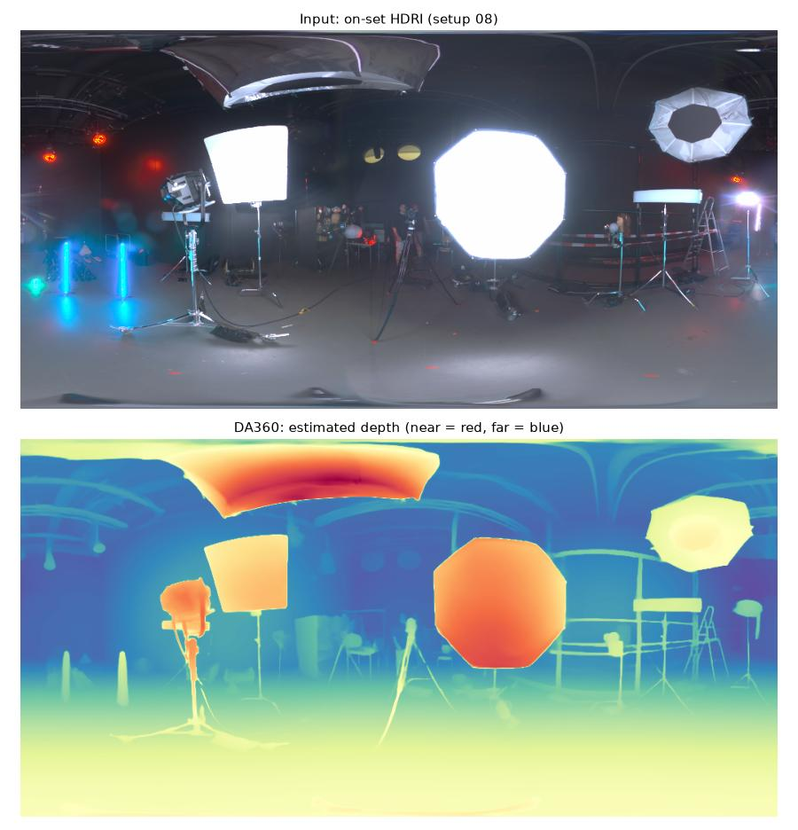
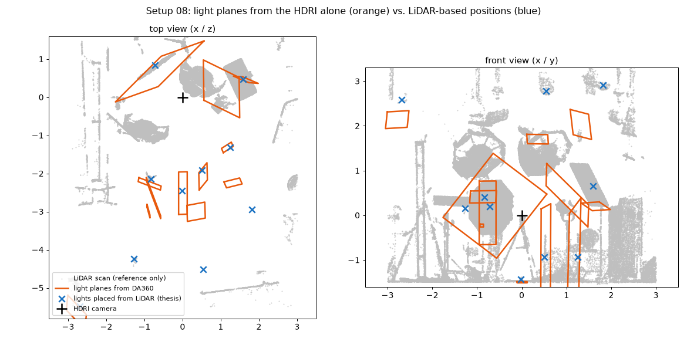
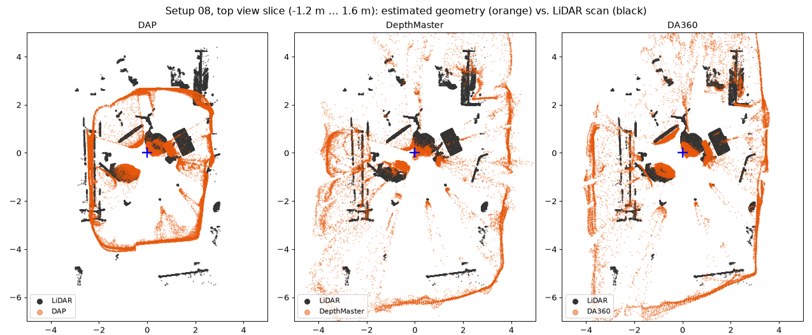

# Automatic IBL Light Rigs from HDRI + LiDAR

Houdini tool that turns an on-set HDRI and a LiDAR scan into a textured **USD light rig**, built for my bachelor thesis *„Automatisierung in Image-Based-Lighting-Workflows“* (B.Eng. Audiovisual Media, Hochschule der Medien Stuttgart, 2025).

From one on-set HDRI and a LiDAR scan of the set, the tool detects the light sources, paints them out of the HDRI, places textured area lights in 3D and exports the rig as USD. The thesis evaluates it on six real studio setups.

**New:** an alternative HDRI-only mode estimates the set geometry with the panoramic depth model DA360 instead of a LiDAR scan. It needs no scan on set but places the lights less precisely. See [Update: HDRI-only mode with DA360](#update-hdri-only-mode-with-da360-no-lidar).

📄 [Full thesis (German, PDF)](docs/bachelor-thesis-brednich-2025.pdf)

https://github.com/user-attachments/assets/7370abba-4f38-4e1e-b838-44a1fc367af9


---

## The problem

For CG integration, lighting artists rebuild the on-set lighting from an HDRI. A modern image-based-lighting workflow does not only use the HDRI as a dome light: the main lights are rebuilt as separate **area lights with textures** cut from the HDRI, and those lights are **painted out** of the dome so they do not contribute twice. Each area light also has to be **placed in 3D** where the real fixture stood.

Done by hand, this means selecting every light in the HDRI, cropping its texture, painting it out and positioning, rotating and sizing an area light for it. Studio tools cover parts of this: DNEG's iblManager detects lights in the HDRI, and ILM's LightCraft places them in 3D from two HDRIs with manually picked corners. As far as published, none does the whole chain in one place.

The thesis asks how much of this workflow can be automated in a single tool, and how accurate the result is. LiDAR scans are usually captured on set anyway, so the tool uses them for the 3D placement.

## How it works

The tool is a Houdini Digital Asset. Most of the logic is built from nodes; the Python SOP shown below creates the lights at the end.

1. **Detect light sources (COPs).** A colour-correct with a negative *Add* value works as a luminance threshold: everything below it becomes negative, everything above it counts as a light source. The artist sets the threshold and can refine the selection directly in the COP network, e.g. with roto shapes.
2. **Paint out (COPs).** An inverted luma key of the thresholded image gives an alpha for everything except the lights. Premultiply, a strong blur and unpremultiply fill the holes, a classic compositing inpaint. The result becomes the dome light.
3. **Project onto the LiDAR scan (SOPs).** The HDRI is projected onto the scan with a polar UV projection from the capture position. The thresholded image is read into a point attribute, and everything below the threshold is deleted, which leaves only the scan geometry of the light fixtures.
4. **Fit a grid per light (for-each loop).** For every piece the tool computes the average normal and the centroid, copies a grid onto it, aligns it to the normal and matches its size. *Size factor* enlarges the grids so textures are not cut off. *Merge close lights* joins pieces that a gap in the scan split into several parts.
5. **Render textures and create lights (for-each loop).** A wrangle computes each grid's UV bounds, and a crop in COPs cuts the matching region from the HDRI. *Extract Transform* gives the grid's rotation matrix, and the [Python SOP](python/create_area_light.py) turns it into Euler angles and a light size, renders the texture, creates the area light and links the texture. On the first iteration it also creates the dome light.
6. **Check and export.** Buttons on the HDA switch between the intermediate states: the HDRI projection, the selected light geometry and the created lights. The rig is exported as USD.

## Results

Evaluation setup: 6 studio setups with 61 lights in total (spotlights, panels, softboxes, Astera tubes, DMG Dash), each documented in a light plan. One HDRI per setup (Ricoh Theta Z1) and two LiDAR scans (Faro Focus): a high-resolution scan from several positions (2:50 min per position) and a quick single-position scan from the HDRI position (1:10 min).

| | High-res scan | Quick single scan |
|---|---|---|
| Lights detected (mean recall) | 96 % (≥ 90 % in every setup) | 96 % |
| Precision | 89 % | 91 % |
| Mean position deviation per axis | 2.5 – 3.3 cm | 3.6 cm (x), 11 – 12 cm (y, z) |
| Mean rotation deviation per axis | 5.5 – 12.3° | up to 24° |
| Textures without artifacts | 80 % | 77 % |
| Lights removed by paintout / artifact-free | 100 % / 97 % | 100 % / 97 % |

- With both scan qualities almost all position deviations are below 20 cm. That is in the range of published research methods (Powell et al. 2001: 11 cm median error; Aoto et al. 2012: max. 14 cm), which need extra reference objects on set.
- The quick 70-second scan gives nearly the same detection and texture results, so the method costs very little time on set.
- Light size deviates by about 20 cm on average, mostly because *size factor* (default 1.4) enlarges the lights on purpose. Larger area lights are not a problem, since the texture defines the actual emitting shape.
- USD export to Maya: all area lights arrive with correct position and size.

## Manual steps and limitations

The tool automates most of the workflow, but not all of it:

- **Threshold:** the luminance threshold and the size and merge parameters are set by the artist. For the evaluation they were tuned for maximum recall.
- **Occlusion:** the projection cannot handle occlusion. A wall behind a fixture, or the back of the fixture itself, receives the same texture region as the light. Houdini's Ray SOP did not solve this reliably on dense scans. For the evaluation, geometry behind the lights was removed from the scans by hand. Otherwise the tool creates extra false lights that have to be deleted afterwards.
- **Rotation** is the weakest estimate. Polygons on the sides or back of a fixture flow into the averaged normal.
- **Textures:** about 20 % show artifacts. Some are an implementation bug: a light that crosses the UV seam of the polar projection gets a crop over almost the full HDRI width. The others come from imprecise rotation or size, which cuts off part of the light. Because texture extraction depends on the 3D placement, these cannot be fixed by hand yet. A next step would be to re-project the texture after manually correcting a light.
- **USD to Maya:** textures have to be relinked, and the dome light is not transferred.
- **Scope of the evaluation:** one studio, six setups, one HDRI camera, one scanner. Lens distortion was not removed from the HDRIs. Outdoor sets and real production conditions were not tested.

## Code

[`python/create_area_light.py`](python/create_area_light.py) is the Python SOP from the last for-each loop. It runs once per detected light and

- converts the grid's rotation matrix into Euler angles,
- measures the grid for the area light size,
- renders the light's texture through the COP network into a versioned folder,
- creates the area light and, on the first run, the dome light.

It depends on the surrounding HDA network (relative node paths, a custom light node), so it is meant for reading, not for running on its own.

## Update: HDRI-only mode with DA360 (no LiDAR)

Version 11 of the HDA adds a second geometry source: instead of a LiDAR scan, the 3D geometry is **estimated from the HDRI itself** with the panoramic depth model [DA360](https://github.com/Insta360-Research-Team/DA360) (Insta360 Research, MIT license). A switch on the HDA selects *LiDAR scan* (the original workflow, unchanged) or *DA360 (from HDRI)*.

No scan is needed on set any more, only the HDRI and the height of the camera. The trade-off is precision: lights are found almost as reliably as with LiDAR, but their position is off by decimetres instead of centimetres.



### How it works

1. **Depth from the HDRI.** A button on the HDA (*Compute depth*) runs [`da360_houdini.py`](python/da360_houdini.py) in an external Python with PyTorch. The script downsamples the HDRI to the model resolution (1036 × 518), runs DA360 and gets a depth value for every pixel. This takes about 10 s on a MacBook GPU. Houdini itself never loads the 1.3 GB model.
2. **Point cloud.** Every pixel becomes a point. Its direction comes from the same polar projection the tool already uses for the textures, its distance from DA360. DA360 only predicts relative depth, so the cloud is scaled until the floor sits at the known camera height. Each point keeps the linear HDR colour of its pixel.
3. **Same light rig as before.** The point cloud replaces the LiDAR scan. Bright points are grouped into light sources, and the remaining steps run exactly as in the LiDAR mode: grid fitting, texture crop, area lights and USD export. Since every detected point was seen from the HDRI camera, the light planes face the camera.

### Results

Evaluated on six studio setups selected from the thesis evaluation (61 lights), against the lights placed from the high-resolution LiDAR scan.

| | LiDAR mode (thesis) | DA360 mode |
|---|---|---|
| Needs on set | HDRI + LiDAR scan | HDRI + camera height |
| Lights detected (mean recall) | 96 % | 89 % |
| Precision | 89 % | 64 % |
| Mean position deviation per axis | 2.5 – 3.3 cm | 24 / 28 / 45 cm (x / y / z) |
| Mean size deviation (width / height) | 25 / 25 cm | 33 / 28 cm |
| Geometry step | scan on set (1–3 min per position) | ~10 s per HDRI |

- **Direction is accurate, distance is not.** A light's direction is right to within 2–4°. Almost the whole position error is in the distance. Lights within about 2 m of the camera are 25–40 cm off (median over all lights: 39 cm). Small ceiling and background lights can be off by 1–2 m.
- **Detection** is close to the LiDAR mode. Precision is lower because brightly lit surfaces and highlights sometimes count as extra lights, which have to be deleted by hand.
- **Size** is in a similar range. In some setups it is even closer than in the LiDAR mode, where the scan geometry of a fixture tends to be larger than its emitting surface.



*Setup 08: light planes from the HDRI alone (orange) and the light positions from the LiDAR workflow (blue). The scan is only drawn for reference.*

### Which depth model?

Three current panoramic depth models were tested on the studio setups against the LiDAR scans:

| | [DAP](https://github.com/Insta360-Research-Team/DAP) | [DepthMaster](https://github.com/PolyU-VCLab/DepthMaster) | **[DA360](https://github.com/Insta360-Research-Team/DA360)** |
|---|---|---|---|
| Floor (relative error) | 11–19 % | **5–6 %** | **6–7 %** |
| Light distance (mean error factor) | 54 % | 97 % | **36 %** |
| Runtime per HDRI (Mac) | ~7 s | ~3.5 min | **~2 s** |
| License | CC BY-NC | MIT | **MIT** |

DepthMaster has the best published benchmark scores, but these come from ordinary interiors. In a dark studio with bright lights it places the lights much too close. DAP closes the dark studio into a small box about 2–3 m around the camera. DA360 captures the room most realistically and places the lights best, so the HDA uses it.



### Code

[`python/da360_houdini.py`](python/da360_houdini.py) runs on its own as well:

```bash
python3 da360_houdini.py --hdri set.hdr \
    --da360 /path/to/DA360 --weights /path/to/DA360_large.pth \
    --camera-height 1.48 --out set_da360.ply
```

The core of the script: a depth per pixel, a direction per pixel in the tool's polar projection, and the floor as the scale reference.

```python
depth = run_da360(img, da360_root, weights)          # relative radial depth, H x W

# direction per pixel, same convention as the tool's polar UV projection (Y-up)
u = (np.arange(w) + 0.5) / w
v = 1.0 - (np.arange(h) + 0.5) / h
u, v = np.meshgrid(u, v)
az, el = (u - 0.5) * 2 * np.pi, (v - 0.5) * np.pi
dirs = np.stack([-np.sin(az) * np.cos(el), np.sin(el), np.cos(az) * np.cos(el)], -1)

points = depth[..., None] * dirs
scale = camera_height / -floor_height(points)        # floor = most common height below the camera
points *= scale
```

The button on the HDA starts the script as a separate process and reloads the point cloud afterwards:

```python
cmd = [python, script, "--hdri", hdri, "--da360", da360_dir, "--weights", weights,
       "--out", out, "--camera-height", str(node.parm("da360_camera_height").eval())]
with hou.InterruptableOperation("DA360: compute depth", open_interrupt_dialog=True):
    subprocess.run(cmd, check=True, env=clean_env())  # external Python with torch
node.node("DA360_POINTS").parm("reload").pressButton()
```

### Limitations

- **Position** is the weak point.
- **Rotation:** every light plane faces the HDRI camera. That fits lights aimed at the set, but not lights that shine sideways past it.
- **Setup:** it needs a Python environment with PyTorch, the DA360 code and its weights (about 1.3 GB). The HDA takes all three as paths.
- **Scope:** tested on six studio setups selected from the thesis evaluation. Outdoor sets were not tested.

## Tools

Houdini (SOPs, COPs, VEX, Python), USD, Faro Focus LiDAR, Ricoh Theta Z1.
