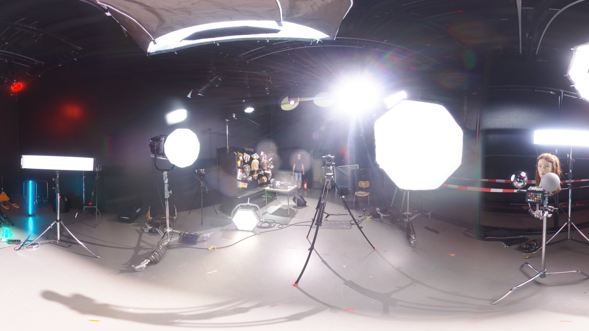

# Automatic IBL Light Rigs from HDRI + LiDAR

Houdini tool that turns an on-set HDRI and a LiDAR scan into a textured **USD light rig**, built for my bachelor thesis *„Automatisierung in Image-Based-Lighting-Workflows“* (B.Eng. Audiovisual Media, Hochschule der Medien Stuttgart, 2025).

From one on-set HDRI and a LiDAR scan of the set, the tool detects the light sources, paints them out of the HDRI, places textured area lights in 3D and exports the rig as USD. The thesis evaluates it on six real studio setups.

*▶ [Watch the 30-second demo video](https://julianbrednich.github.io/Portfolio/#lighting-tool) on my portfolio. The image above is the HDRI of one evaluation setup with 20 lights.*

---

## The problem

For CG integration, lighting artists rebuild the on-set lighting from an HDRI. A modern image-based-lighting workflow does not only use the HDRI as a dome light: the main lights are rebuilt as separate **area lights with textures** cut from the HDRI, and those lights are **painted out** of the dome so they do not contribute twice. Each area light also has to be **placed in 3D** where the real fixture stood.

Done by hand, this means selecting every light in the HDRI, cropping its texture, painting it out and positioning, rotating and sizing an area light for it. Studio tools cover parts of this: DNEG's iblManager detects lights in the HDRI, and ILM's LightCraft places them in 3D from two HDRIs with manually picked corners. As far as published, none does the whole chain in one place.

The thesis asks how much of this workflow can be automated in a single tool, and how accurate the result is. LiDAR scans are usually captured on set anyway, so the tool uses them for the 3D placement.

## How it works

The tool is a Houdini Digital Asset. Most of the logic is built from nodes; the Python SOP shown below creates the lights at the end.

1. **Detect light sources (COPs).** A colour-correct with a negative *Add* value works as a luminance threshold: everything below it becomes negative, everything above it counts as a light source. The artist sets the threshold and can refine the selection directly in the COP network, e.g. with roto shapes.
2. **Paint out (COPs).** An inverted luma key of the thresholded image gives an alpha for everything except the lights. Premultiply, a strong blur and unpremultiply fill the holes, a classic compositing inpaint. The result becomes the dome light.
3. **Project onto the LiDAR scan (SOPs).** The HDRI is projected onto the scan with a polar UV projection from the capture position. The thresholded image is read into a point attribute, and everything below the threshold is deleted, which leaves only the scan geometry of the light fixtures.
4. **Fit a grid per light (for-each loop).** For every piece the tool computes the average normal and the centroid, copies a grid onto it, aligns it to the normal and matches its size. *Size factor* enlarges the grids so textures are not cut off. *Merge close lights* joins pieces that a gap in the scan split into several parts.
5. **Render textures and create lights (for-each loop).** A wrangle computes each grid's UV bounds, and a crop in COPs cuts the matching region from the HDRI. *Extract Transform* gives the grid's rotation matrix, and the [Python SOP](python/create_area_light.py) turns it into Euler angles and a light size, renders the texture, creates the area light and links the texture. On the first iteration it also creates the dome light.
6. **Check and export.** Buttons on the HDA switch between the intermediate states: the HDRI projection, the selected light geometry and the created lights. The rig is exported as USD.

## Results

Evaluation setup: 6 studio setups with 61 lights in total (spotlights, panels, softboxes, Astera tubes, DMG Dash), each documented in a light plan. One HDRI per setup (Ricoh Theta Z1) and two LiDAR scans (Faro Focus): a high-resolution scan from several positions (2:50 min per position) and a quick single-position scan from the HDRI position (1:10 min).

| | High-res scan | Quick single scan |
|---|---|---|
| Lights detected (mean recall) | 96 % (≥ 90 % in every setup) | 96 % |
| Precision | 89 % | 91 % |
| Mean position deviation per axis | 2.5 – 3.3 cm | 3.6 cm (x), 11 – 12 cm (y, z) |
| Mean rotation deviation per axis | 5.5 – 12.3° | up to 24° |
| Textures without artifacts | 80 % | 77 % |
| Lights removed by paintout / artifact-free | 100 % / 97 % | 100 % / 97 % |

- With both scan qualities almost all position deviations are below 20 cm. That is in the range of published research methods (Powell et al. 2001: 11 cm median error; Aoto et al. 2012: max. 14 cm), which need extra reference objects on set.
- The quick 70-second scan gives nearly the same detection and texture results, so the method costs very little time on set.
- Light size deviates by about 20 cm on average, mostly because *size factor* (default 1.4) enlarges the lights on purpose. Larger area lights are not a problem, since the texture defines the actual emitting shape.
- USD export to Maya: all area lights arrive with correct position and size.

## Manual steps and limitations

The tool automates most of the workflow, but not all of it:

- **Threshold:** the luminance threshold and the size and merge parameters are set by the artist. For the evaluation they were tuned for maximum recall.
- **Occlusion:** the projection cannot handle occlusion. A wall behind a fixture, or the back of the fixture itself, receives the same texture region as the light. Houdini's Ray SOP did not solve this reliably on dense scans. For the evaluation, geometry behind the lights was removed from the scans by hand. Otherwise the tool creates extra false lights that have to be deleted afterwards.
- **Rotation** is the weakest estimate. Polygons on the sides or back of a fixture flow into the averaged normal.
- **Textures:** about 20 % show artifacts. Some are an implementation bug: a light that crosses the UV seam of the polar projection gets a crop over almost the full HDRI width. The others come from imprecise rotation or size, which cuts off part of the light. Because texture extraction depends on the 3D placement, these cannot be fixed by hand yet. A next step would be to re-project the texture after manually correcting a light.
- **USD to Maya:** textures have to be relinked, and the dome light is not transferred.
- **Scope of the evaluation:** one studio, six setups, one HDRI camera, one scanner. Lens distortion was not removed from the HDRIs. Outdoor sets and real production conditions were not tested.

## Code

[`python/create_area_light.py`](python/create_area_light.py) is the Python SOP from the last for-each loop. It runs once per detected light and

- converts the grid's rotation matrix into Euler angles,
- measures the grid for the area light size,
- renders the light's texture through the COP network into a versioned folder,
- creates the area light and, on the first run, the dome light.

It depends on the surrounding HDA network (relative node paths, a custom light node), so it is meant for reading, not for running on its own.

## Tools

Houdini (SOPs, COPs, VEX, Python), USD, Faro Focus LiDAR, Ricoh Theta Z1.
